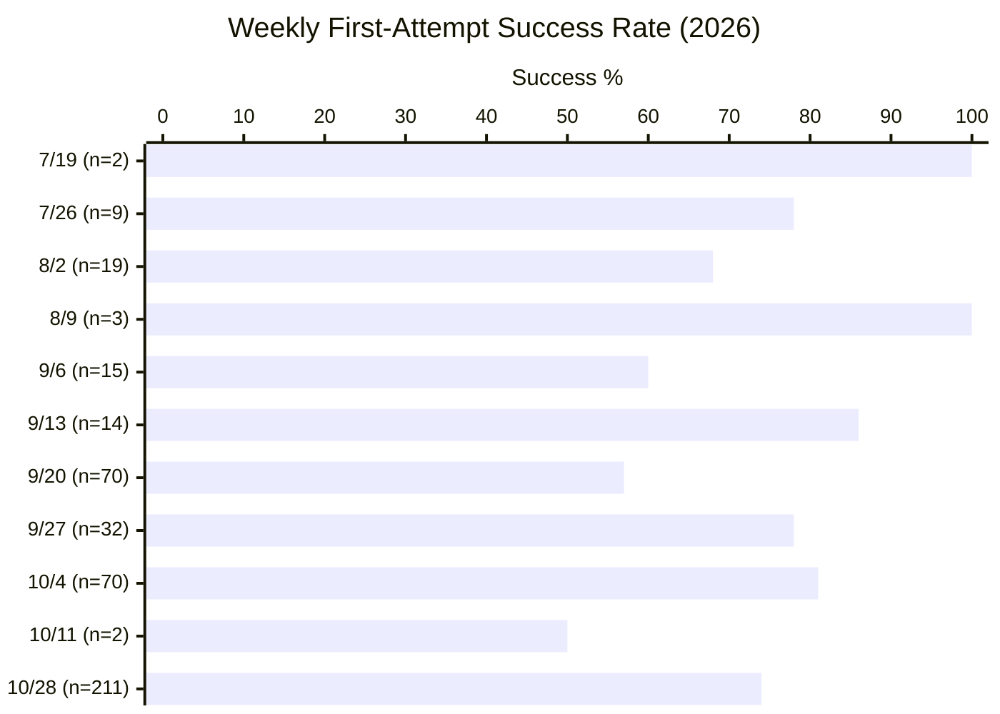
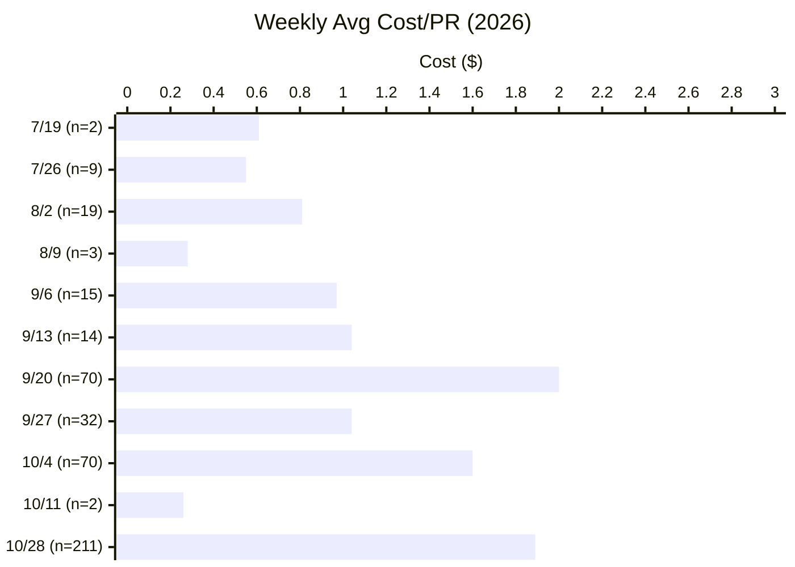
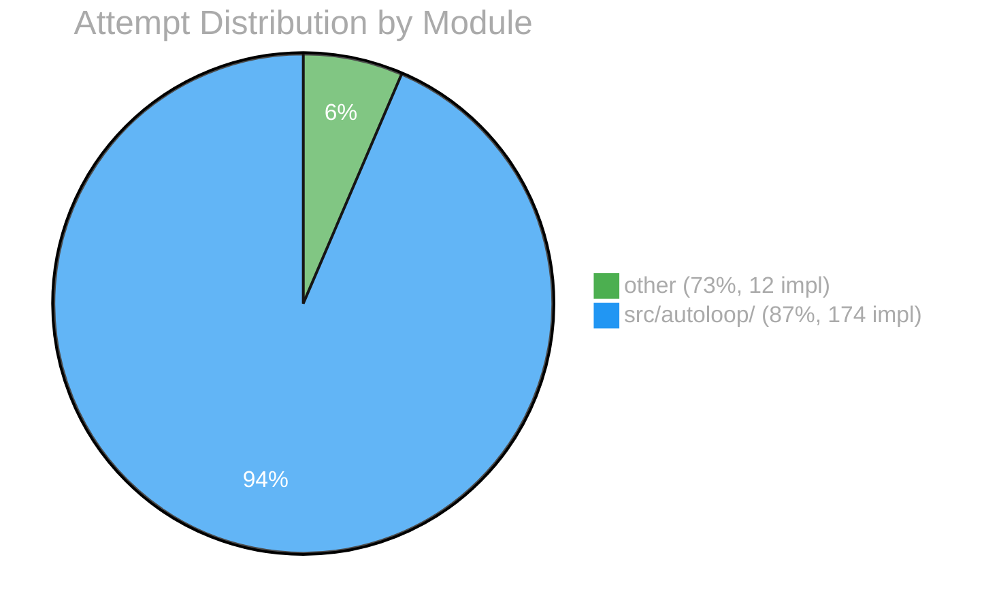

# EVAL Report

Report date 2026-10-28: data as of 2026-10-27T19:18:54.636679+00:00, 414 history rows.

## Overall

| Metric | Value | Pending |
|--------|-------|---------|
| Total PRs | 174 | — |
| First-attempt success | 74% (n=211 implement runs) | pending: 0 |
| Avg cost/run | $1.89 (n=211 implement runs) | included |
| Avg review cost/run | $0.21 (n=4 implement runs) | included |
| Human edit rate | 17% (n=174 merged PRs; edited by a human PR within 7 days) | pending: 0 |

## Definitions

| Metric | Numerator | Denominator | Counts | Window |
|--------|-----------|-------------|--------|--------|
| First-attempt success | implement runs that succeeded with attempts == 1 | implement runs with an outcome (pending runs excluded) | `run_history` rows with type "implement" and a non-zero issue (triage, review and issue-0 rows are excluded) | Overall: lifetime. Trend: change since the previous snapshot (snapshots without outcome counts use the attempt distribution) |
| Human edit rate | merged PRs with a non-autoloop PR merged within the fixup window that touches the same files (bookkeeping files, release and eval-report PRs are ignored) | merged PRs (open PRs are pending; closed unmerged PRs excluded) | PRs from `autoloop/` branches, up to the 500 most recent | Overall: lifetime. Trend: new edits / new merges since the previous snapshot; invalid when edits exceed merges (older PRs flagged late) |
| Avg cost/run | sum of implementation cost over implement runs: `impl_cost_usd` when logged, else `cost_usd` (rows before #451 never included review cost) | implement runs, pending included (cost is known when a run ends) | `run_history` rows with type "implement" and a non-zero issue (triage, review and issue-0 rows are excluded) | Overall: lifetime. Trend: change in total cost / change in implement runs |
| Avg review cost/run | sum of `review_cost_usd` over implement runs that logged it | implement runs with `review_cost_usd` (none is imputed for older rows) | `run_history` rows with type "implement" and a non-zero issue (triage, review and issue-0 rows are excluded); logged from #451 onward only | Overall: lifetime, shown only when n > 0 |

Pending: a successful implement run whose PR is still open, or an open PR. Pending items are left out of outcome-dependent denominators and shown as a separate pending count. Any rate whose numerator exceeds its denominator renders as invalid.

## Per-Module Breakdown

| Module | Success | Avg Cost | Impl | Auto-merge ready? |
|--------|---------|----------|------|--------------------|
| other | insufficient data (n=11 runs) | insufficient data (n=11 runs) | 12 | No |
| src/autoloop/ | 87% (n=163 runs) | $1.80 (n=163 runs) | 174 | No |

## Trend

| Date (UTC) | New PRs | First-attempt | Avg Cost | Human Edits |
|------|---------|---------------|----------|-------------|
| 2026-07-19 | 12 | 100% | $0.61 | 8% |
| 2026-07-26 | 6 | 78% | $0.55 | 0% |
| 2026-08-02 | 12 | 68% | $0.81 | 25% |
| 2026-08-09 | 2 | 100% | $0.28 | 50% |
| 2026-09-06 | 7 | 60% | $0.97 | 14% |
| 2026-09-13 | 7 | 86% | $1.04 | 14% |
| 2026-09-18 | 19 | 56% | $2.04 | 16% |
| 2026-09-19 | 3 | 71% | $1.63 | 0% |
| 2026-09-20 | 0 | — | — | — |
| 2026-09-21 | 4 | 88% | $0.75 | 0% |
| 2026-09-22 | 2 | 67% | $1.41 | 0% |
| 2026-09-23 | 0 | 100% | $1.41 | — |
| 2026-09-24 | 4 | 100% | $1.66 | 0% |
| 2026-09-25 | 0 | — | — | — |
| 2026-09-27 | 9 | 62% | $0.79 | 22% |
| 2026-09-29 | 23 | 77% | $1.26 | invalid |
| 2026-10-01 | 19 | 85% | $2.44 | 0% |
| 2026-10-02 | 2 | 100% | $0.34 | invalid |
| 2026-10-03 | 2 | 0% | $1.47 | — |
| 2026-10-04 | 6 | 100% | $0.07 | invalid |
| 2026-10-05 | 0 | — | — | — |
| 2026-10-06 | 3 | 50% | $0.26 | 0% |
| 2026-10-07 | 1 | — | — | — |
| 2026-10-08 | 0 | — | — | — |
| 2026-10-09 | 1 | — | — | — |
| 2026-10-10 | 2 | — | — | — |
| 2026-10-11 | 0 | — | — | — |
| 2026-10-12 | 0 | — | — | — |
| 2026-10-13 | 0 | — | — | — |
| 2026-10-14 | 0 | — | — | — |
| 2026-10-15 | 0 | — | — | — |
| 2026-10-16 | 0 | — | — | — |
| 2026-10-17 | 0 | — | — | — |
| 2026-10-18 | 0 | — | — | — |
| 2026-10-19 | 0 | — | — | — |
| 2026-10-20 | 0 | — | — | — |
| 2026-10-21 | 0 | — | — | — |
| 2026-10-22 | 0 | — | — | — |
| 2026-10-23 | 0 | — | — | — |
| 2026-10-24 | 0 | — | — | — |
| 2026-10-25 | 0 | — | — | — |
| 2026-10-26 (baseline break) | 18 | 73% | $1.93 | 51% |
| 2026-10-27 | 0 | — | — | — |
| 2026-10-28 (baseline break) | 10 | 100% | $1.09 | 17% |

> Baseline break at 2026-10-26: earlier snapshots counted triage runs as implementations (#400), so their first-attempt and cost values are not comparable with later rows.

> Baseline break at 2026-10-28: human edits are counted under a 7-day window from this row on, so earlier human edit rates are not comparable with later rows.

