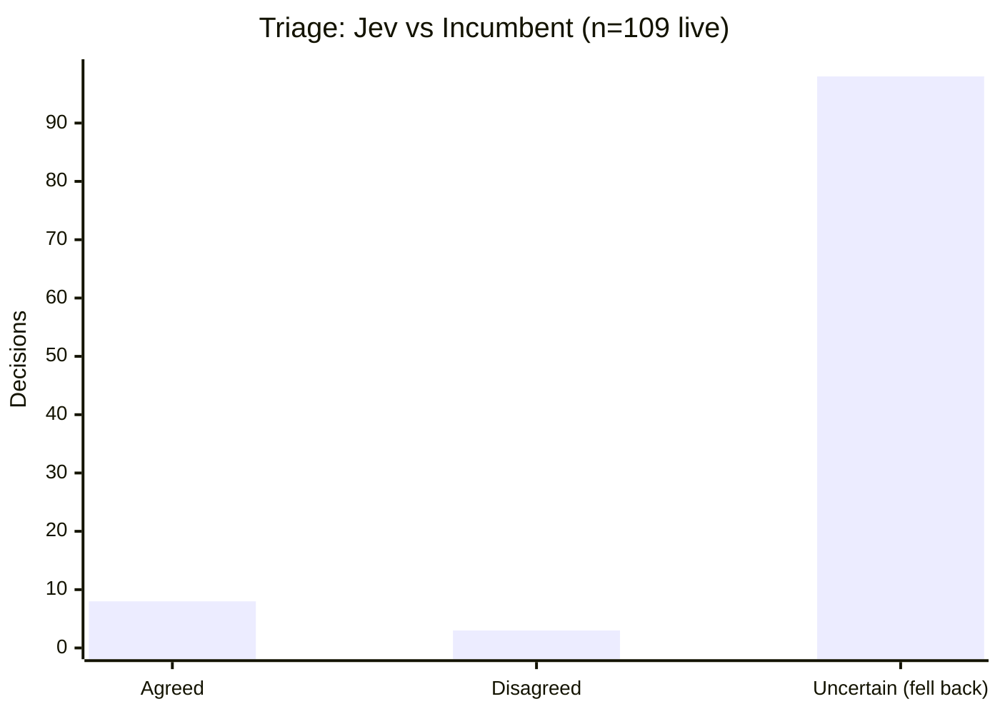
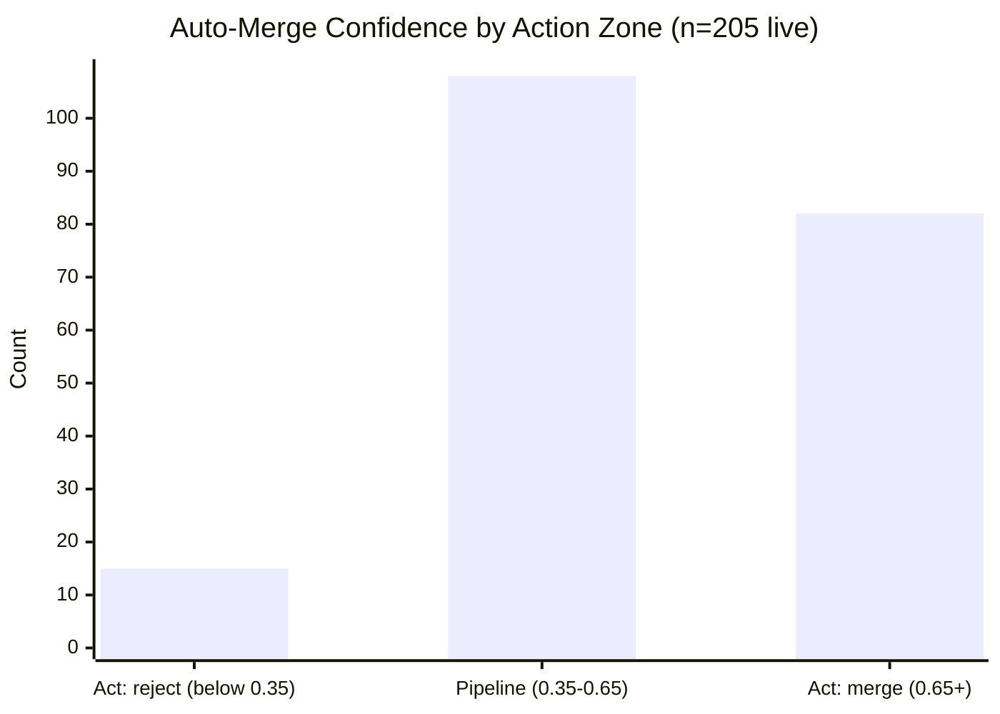
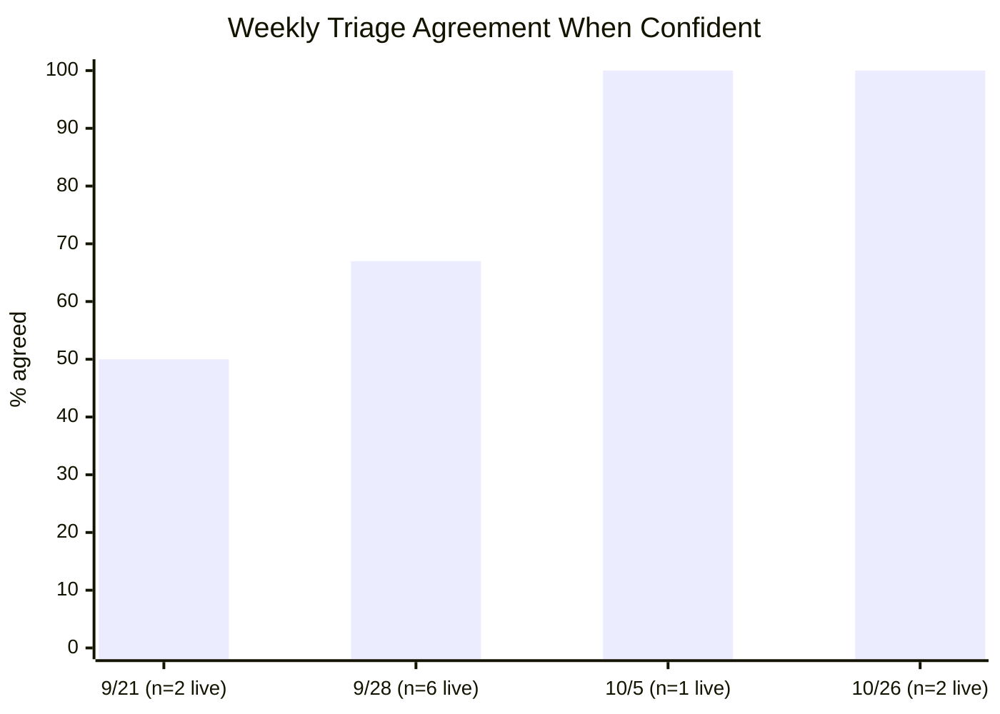
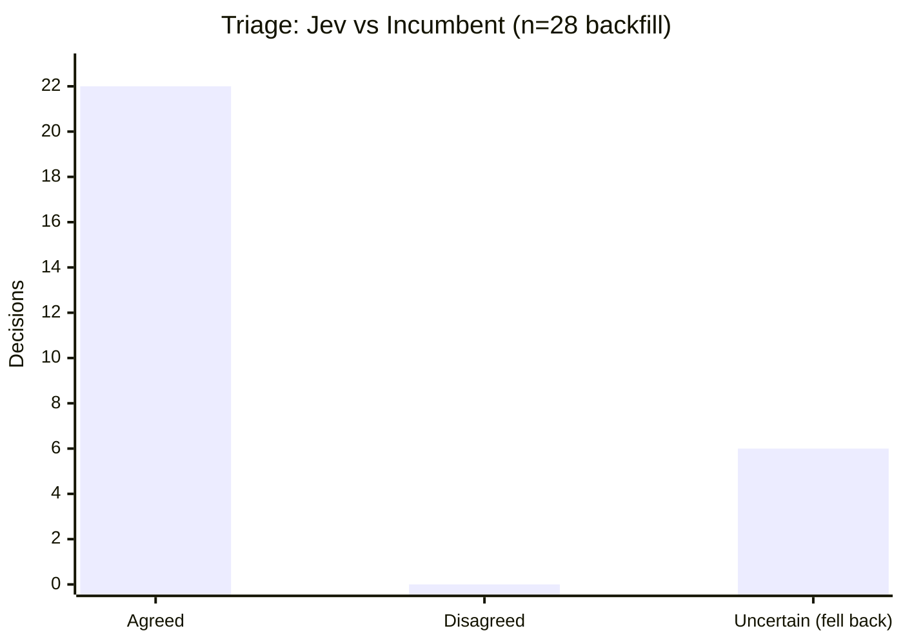
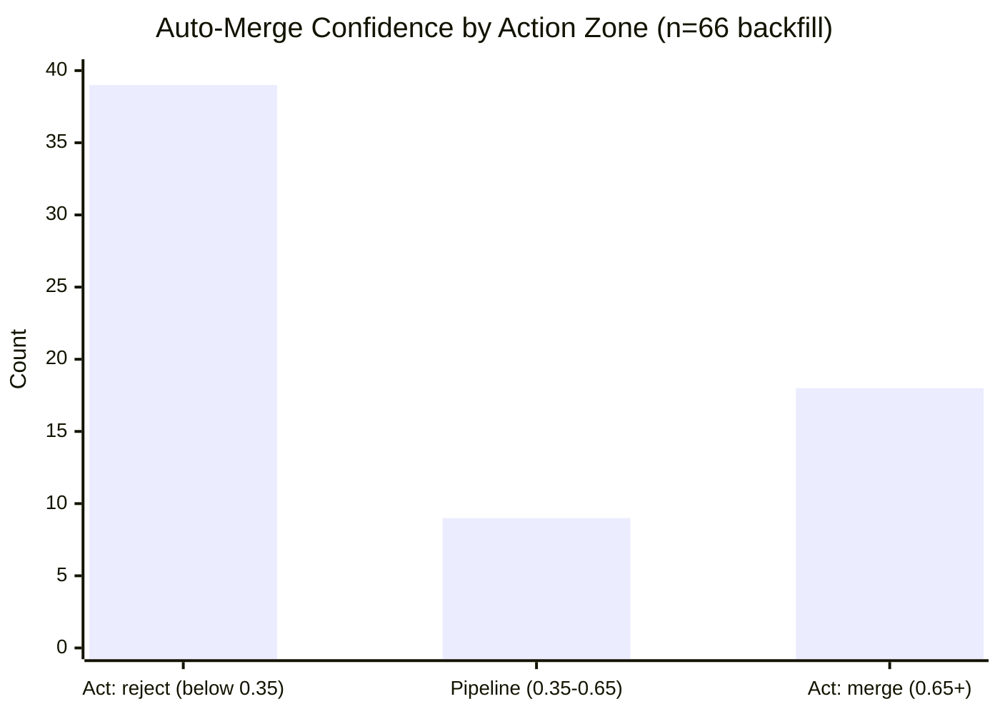
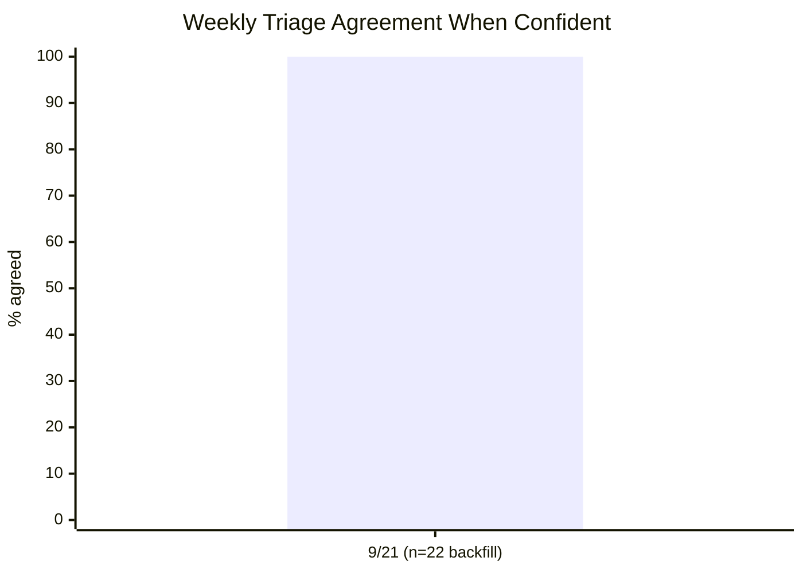

# JEV Report

**Verdict:** Jev agreed on 73% (n=11 live) of confident calls

## Charts

## Counts

- **Total entries:** 442
- **Live entries:** 330
- **Backfilled entries:** 112
- **Date range:** 2026-07-17 to 2026-11-08

## Triage Agreement

- **Agreed:** 8 of 109
- **Disagreed:** 3 of 109
- **Uncertain (fell back):** 98 of 109
- **When confident, agreed:** 8 of 11 — 73% (n=11 live)
- **Disagreement breakdown:**
  - ready-vs-rejected: 3

### Weekly Trends

| Week | Agreed | Disagreed | Uncertain | n |
|------|--------|-----------|-----------|---|
| 9/21 | 1 | 1 | 19 | 21 |
| 9/28 | 4 | 2 | 31 | 37 |
| 10/5 | 1 | 0 | 5 | 6 |
| 10/26 | 2 | 0 | 38 | 40 |
| 11/2 | 0 | 0 | 5 | 5 |

## Auto-Merge Agreement

- **Mean confidence:** 0.590 (n=205 live)
- **Median confidence:** 0.590 (n=205 live)
- **Agreement with incumbent decision:** 49/69 — 71% (n=69 live)

### Per-Zone Agreement

| Zone | Agreed | Total | Agreement |
|------|--------|-------|-----------|
| Act: reject (below 0.35) | 2 | 4 | 50% (n=4 live) |
| Pipeline (0.35-0.65) | 25 | 39 | 64% (n=39 live) |
| Act: merge (0.65+) | 22 | 26 | 85% (n=26 live) |

## Backfill

### Backfill Triage Agreement

- **Agreed:** 22 of 28
- **Disagreed:** 0 of 28
- **Uncertain (fell back):** 6 of 28
- **When confident, agreed:** 22 of 22 — 100% (n=22 backfill)

### Weekly Trends

| Week | Agreed | Disagreed | Uncertain | n |
|------|--------|-----------|-----------|---|
| 9/21 | 22 | 0 | 6 | 28 |

### Backfill Auto-Merge Agreement

- **Mean confidence:** 0.412 (n=66 backfill)
- **Median confidence:** 0.310 (n=66 backfill)
- **Agreement with incumbent decision:** 9/33 — 27% (n=33 backfill)

### Per-Zone Agreement

| Zone | Agreed | Total | Agreement |
|------|--------|-------|-----------|
| Act: reject (below 0.35) | 1 | 19 | 5% (n=19 backfill) |
| Pipeline (0.35-0.65) | 3 | 9 | 33% (n=9 backfill) |
| Act: merge (0.65+) | 5 | 5 | 100% (n=5 backfill) |

## Legend

- **Incumbent decision:** the human/pipeline decision that was actually used
- **Fell back:** Jev returned an uncertain result and deferred to the incumbent
- **Pipeline (0.35–0.65):** confidence too close to call; Jev defers to the incumbent
- **Backfilled:** a decision reconstructed from historical data, not made live
- **n=… live / n=… backfill:** the sample behind a number; live and backfilled decisions are never pooled

---

*Generated at 2026-11-08 21:37 UTC*