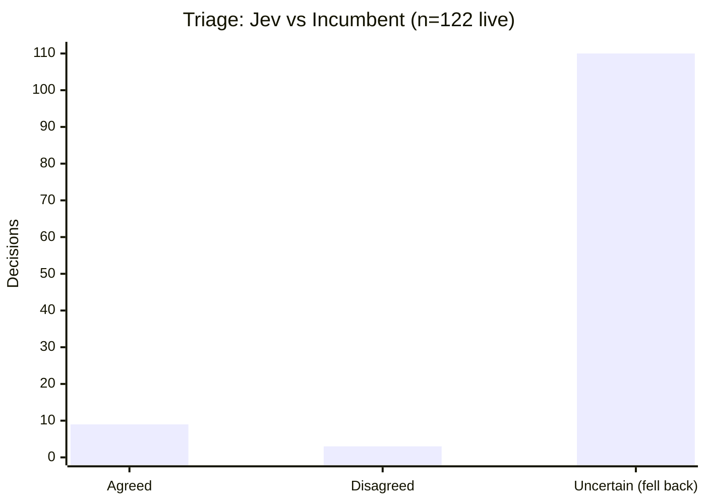
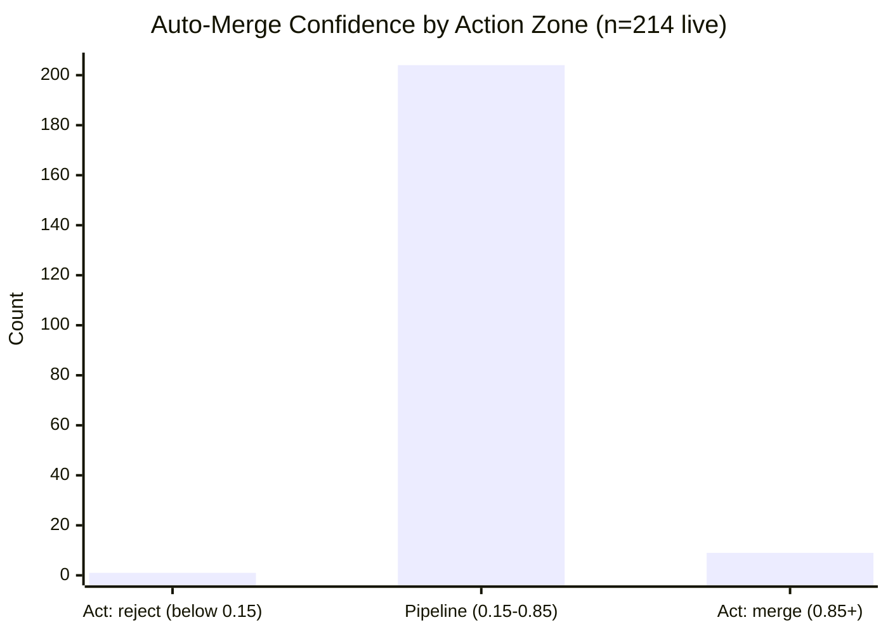
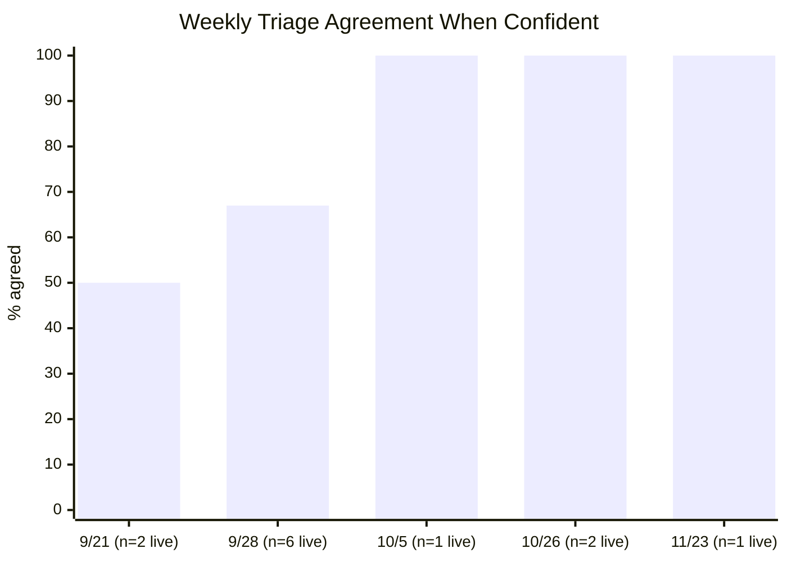
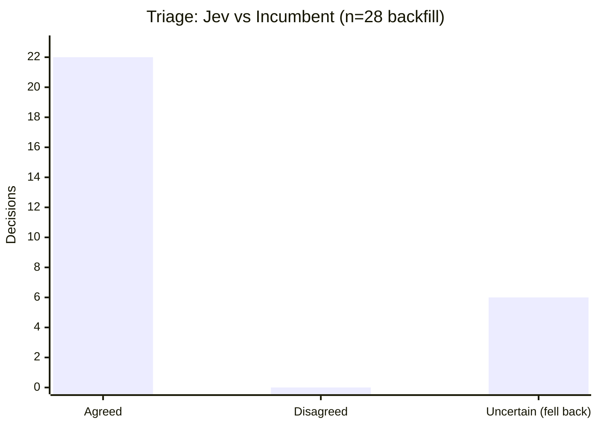
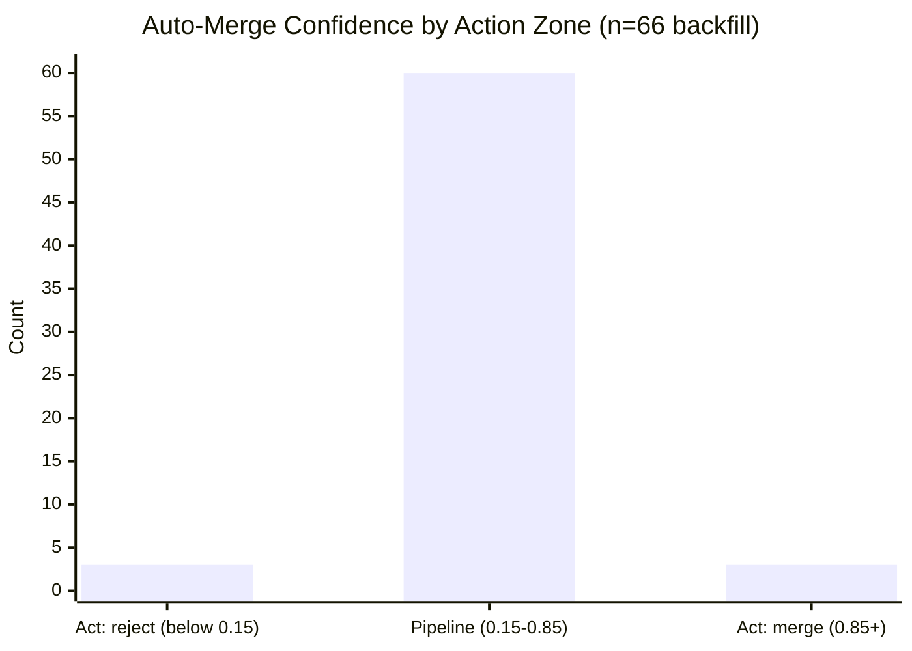
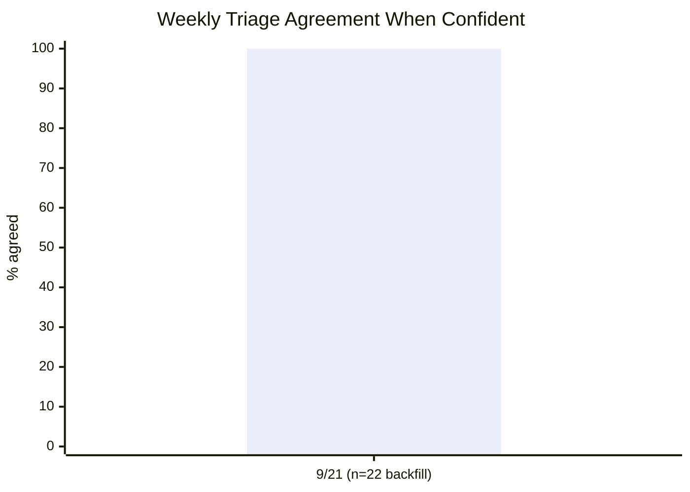

# JEV Report

**Verdict:** Jev agreed on 75% (n=12 live) of confident calls

**Band:** 0.15–0.85 (from config); triage.needs_decomposition: 0.35–0.85

## Charts

## Counts

- **Total entries:** 464
- **Live entries:** 352
- **Backfilled entries:** 112
- **Date range:** 2026-07-17 to 2026-11-27

## Triage Agreement

- **Agreed:** 9 of 122
- **Disagreed:** 3 of 122
- **Uncertain (fell back):** 110 of 122
- **When confident, agreed:** 9 of 12 — 75% (n=12 live)
- **Disagreement breakdown:**
  - ready-vs-rejected: 3

### Weekly Trends

| Week | Agreed | Disagreed | Uncertain | n |
|------|--------|-----------|-----------|---|
| 9/21 | 1 | 1 | 19 | 21 |
| 9/28 | 4 | 2 | 31 | 37 |
| 10/5 | 1 | 0 | 5 | 6 |
| 10/26 | 2 | 0 | 38 | 40 |
| 11/2 | 0 | 0 | 5 | 5 |
| 11/9 | 0 | 0 | 12 | 12 |
| 11/23 | 1 | 0 | 0 | 1 |

## Auto-Merge Agreement

- **Mean confidence:** 0.592 (n=214 live)
- **Median confidence:** 0.595 (n=214 live)
- **Agreement with incumbent decision:** 58/78 — 74% (n=78 live)

### Per-Zone Agreement

| Zone | Agreed | Total | Agreement |
|------|--------|-------|-----------|
| Act: reject (below 0.15) | 1 | 1 | 100% (n=1 live) |
| Pipeline (0.15-0.85) | 57 | 77 | 74% (n=77 live) |
| Act: merge (0.85+) | — | 0 | no outcomes yet |

## Calibration

Live rows only; shadow and backfilled rows are excluded. A suggested band edge needs Jev to match the incumbent on at least 95% of the calls beyond it, with at least n=30 calls.

### triage.well_formed

| Bin | n | % not rejected |
|-----|---|---|
| 0–0.15 | n=1 | 0% |
| 0.15–0.35 | n=0 | — |
| 0.35–0.5 | n=0 | — |
| 0.5–0.65 | n=0 | — |
| 0.65–0.85 | n=5 | 100% |
| 0.85–1 | n=113 | 86% |

- **Band:** 0.15–0.85 (from config)
- **Suggested band edges:** no edge reaches 95% (n=119)
- **Baseline:** always accept: 86%, n=119 vs Jev: 87%, n=119

### triage.needs_decomposition

| Bin | n | % needs-decomposition |
|-----|---|---|
| 0–0.15 | n=10 | 0% |
| 0.15–0.35 | n=33 | 3% |
| 0.35–0.5 | n=21 | 24% |
| 0.5–0.65 | n=26 | 19% |
| 0.65–0.85 | n=27 | 56% |
| 0.85–1 | n=2 | 100% |

- **Band:** 0.35–0.85 (from config)
- **Suggested band edges:** low 0.35 (98%, n=43); high: no edge reaches 95%
- **Baseline:** never decompose: 76%, n=119 vs Jev: 67%, n=119

### auto-merge.meets_acceptance_criteria

| Bin | n | % approved (incumbent verdict) |
|-----|---|---|
| 0–0.15 | n=1 | 0% |
| 0.15–0.35 | n=3 | 67% |
| 0.35–0.5 | n=19 | 63% |
| 0.5–0.65 | n=25 | 92% |
| 0.65–0.85 | n=30 | 87% |
| 0.85–1 | n=0 | — |

- **Yardsticks:** **incumbent verdict** (approved), **final outcome** (merged), **7-day human edit** (no human edit). The incumbent's verdict is not ground truth.
- **Band:** 0.15–0.85 (from config)
- **Suggested band edges:** no edge reaches 95% (n=78)
- **Baseline:** always approve: 81%, n=78 vs Jev: 74%, n=78
- **Baseline (final outcome):** no data (no live rows with a merged or closed-unmerged final_outcome)
- **Baseline (7-day human edit):** no data (run history has no 7-day human-edit signal)

## Backfill

### Backfill Triage Agreement

- **Agreed:** 22 of 28
- **Disagreed:** 0 of 28
- **Uncertain (fell back):** 6 of 28
- **When confident, agreed:** 22 of 22 — 100% (n=22 backfill)

### Weekly Trends

| Week | Agreed | Disagreed | Uncertain | n |
|------|--------|-----------|-----------|---|
| 9/21 | 22 | 0 | 6 | 28 |

### Backfill Auto-Merge Agreement

- **Mean confidence:** 0.412 (n=66 backfill)
- **Median confidence:** 0.310 (n=66 backfill)
- **Agreement with incumbent decision:** 9/33 — 27% (n=33 backfill)

### Per-Zone Agreement

| Zone | Agreed | Total | Agreement |
|------|--------|-------|-----------|
| Act: reject (below 0.15) | 0 | 2 | 0% (n=2 backfill) |
| Pipeline (0.15-0.85) | 9 | 31 | 29% (n=31 backfill) |
| Act: merge (0.85+) | — | 0 | no outcomes yet |

## Legend

- **Incumbent decision:** the human/pipeline decision that was actually used
- **Fell back:** Jev returned an uncertain result and deferred to the incumbent
- **Pipeline:** confidence too close to call; Jev defers to the incumbent
  - triage.well_formed: 0.15–0.85
  - triage.needs_decomposition: 0.35–0.85
  - auto-merge.meets_acceptance_criteria: 0.15–0.85
- **Backfilled:** a decision reconstructed from historical data, not made live
- **n=… live / n=… backfill:** the sample behind a number; live and backfilled decisions are never pooled

---

*Generated at 2026-11-28 05:40 UTC*