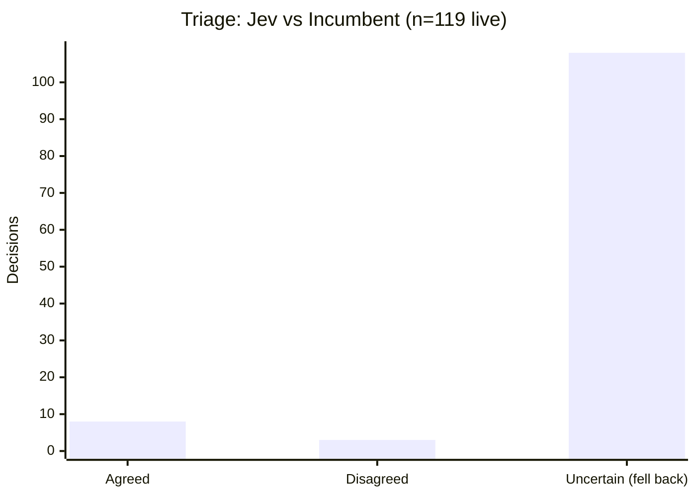
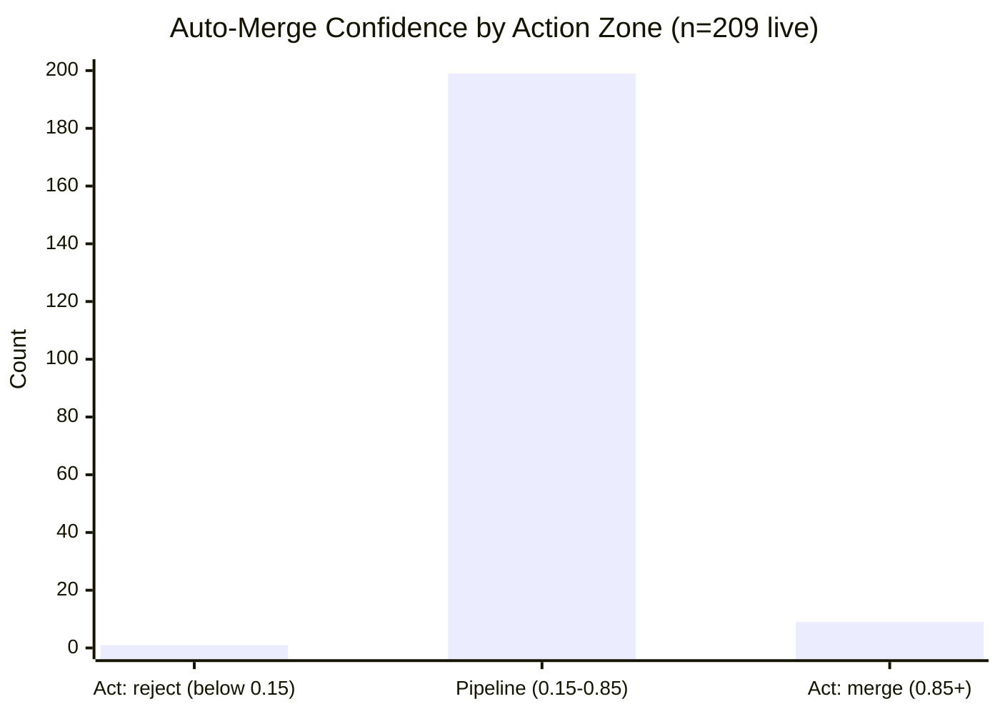
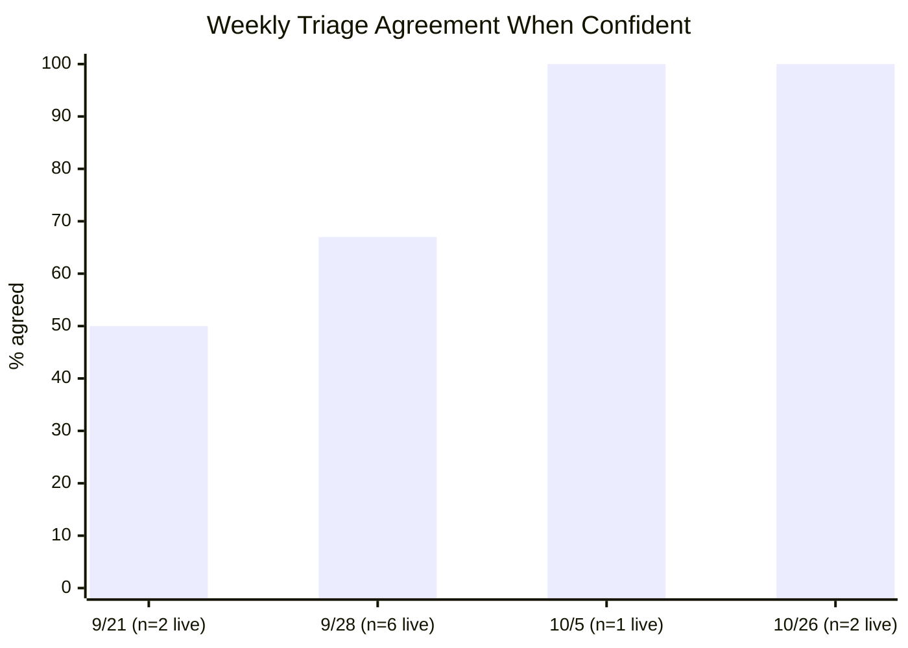
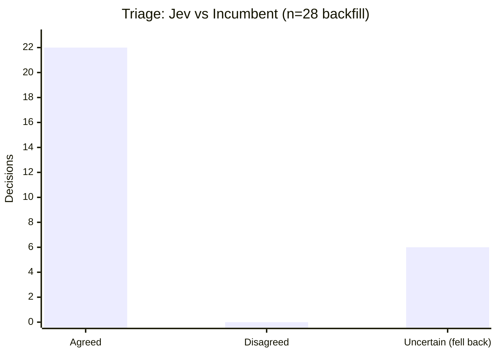
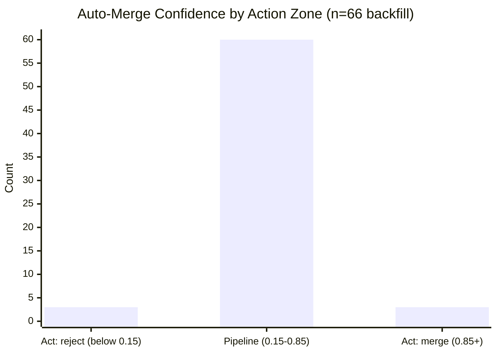
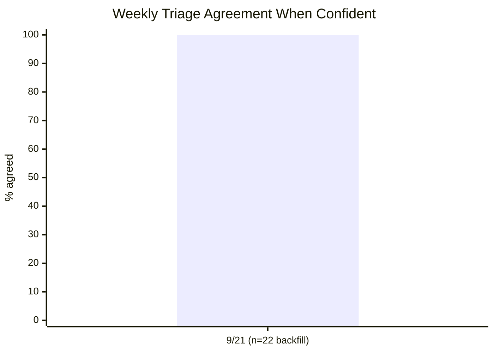

# JEV Report

**Verdict:** Jev agreed on 73% (n=11 live) of confident calls

**Band:** 0.15–0.85 (from config)

## Charts

## Counts

- **Total entries:** 456
- **Live entries:** 344
- **Backfilled entries:** 112
- **Date range:** 2026-07-17 to 2026-11-09

## Triage Agreement

- **Agreed:** 8 of 119
- **Disagreed:** 3 of 119
- **Uncertain (fell back):** 108 of 119
- **When confident, agreed:** 8 of 11 — 73% (n=11 live)
- **Disagreement breakdown:**
  - ready-vs-rejected: 3

### Weekly Trends

| Week | Agreed | Disagreed | Uncertain | n |
|------|--------|-----------|-----------|---|
| 9/21 | 1 | 1 | 19 | 21 |
| 9/28 | 4 | 2 | 31 | 37 |
| 10/5 | 1 | 0 | 5 | 6 |
| 10/26 | 2 | 0 | 38 | 40 |
| 11/2 | 0 | 0 | 5 | 5 |
| 11/9 | 0 | 0 | 10 | 10 |

## Auto-Merge Agreement

- **Mean confidence:** 0.591 (n=209 live)
- **Median confidence:** 0.590 (n=209 live)
- **Agreement with incumbent decision:** 53/73 — 73% (n=73 live)

### Per-Zone Agreement

| Zone | Agreed | Total | Agreement |
|------|--------|-------|-----------|
| Act: reject (below 0.15) | 1 | 1 | 100% (n=1 live) |
| Pipeline (0.15-0.85) | 52 | 72 | 72% (n=72 live) |
| Act: merge (0.85+) | — | 0 | no outcomes yet |

## Calibration

Live rows only; shadow and backfilled rows are excluded. A suggested band edge needs Jev to match the incumbent on at least 95% of the calls beyond it, with at least n=30 calls.

### triage.well_formed

| Bin | n | % not rejected |
|-----|---|---|
| 0–0.15 | n=1 | 0% |
| 0.15–0.35 | n=0 | — |
| 0.35–0.5 | n=0 | — |
| 0.5–0.65 | n=0 | — |
| 0.65–0.85 | n=5 | 100% |
| 0.85–1 | n=110 | 85% |

- **Suggested band edges:** no edge reaches 95% (n=116)
- **Baseline:** always accept: 85%, n=116 vs Jev: 86%, n=116

### triage.needs_decomposition

| Bin | n | % needs-decomposition |
|-----|---|---|
| 0–0.15 | n=10 | 0% |
| 0.15–0.35 | n=31 | 3% |
| 0.35–0.5 | n=20 | 25% |
| 0.5–0.65 | n=26 | 19% |
| 0.65–0.85 | n=27 | 56% |
| 0.85–1 | n=2 | 100% |

- **Suggested band edges:** low 0.35 (98%, n=41); high: no edge reaches 95%
- **Baseline:** never decompose: 76%, n=116 vs Jev: 66%, n=116

### auto-merge.meets_acceptance_criteria

| Bin | n | % approved |
|-----|---|---|
| 0–0.15 | n=1 | 0% |
| 0.15–0.35 | n=3 | 67% |
| 0.35–0.5 | n=19 | 63% |
| 0.5–0.65 | n=23 | 91% |
| 0.65–0.85 | n=27 | 85% |
| 0.85–1 | n=0 | — |

- **Suggested band edges:** no edge reaches 95% (n=73)
- **Baseline:** always approve: 79%, n=73 vs Jev: 73%, n=73

## Backfill

### Backfill Triage Agreement

- **Agreed:** 22 of 28
- **Disagreed:** 0 of 28
- **Uncertain (fell back):** 6 of 28
- **When confident, agreed:** 22 of 22 — 100% (n=22 backfill)

### Weekly Trends

| Week | Agreed | Disagreed | Uncertain | n |
|------|--------|-----------|-----------|---|
| 9/21 | 22 | 0 | 6 | 28 |

### Backfill Auto-Merge Agreement

- **Mean confidence:** 0.412 (n=66 backfill)
- **Median confidence:** 0.310 (n=66 backfill)
- **Agreement with incumbent decision:** 9/33 — 27% (n=33 backfill)

### Per-Zone Agreement

| Zone | Agreed | Total | Agreement |
|------|--------|-------|-----------|
| Act: reject (below 0.15) | 0 | 2 | 0% (n=2 backfill) |
| Pipeline (0.15-0.85) | 9 | 31 | 29% (n=31 backfill) |
| Act: merge (0.85+) | — | 0 | no outcomes yet |

## Legend

- **Incumbent decision:** the human/pipeline decision that was actually used
- **Fell back:** Jev returned an uncertain result and deferred to the incumbent
- **Pipeline (0.15–0.85):** confidence too close to call; Jev defers to the incumbent
- **Backfilled:** a decision reconstructed from historical data, not made live
- **n=… live / n=… backfill:** the sample behind a number; live and backfilled decisions are never pooled

---

*Generated at 2026-11-10 05:40 UTC*