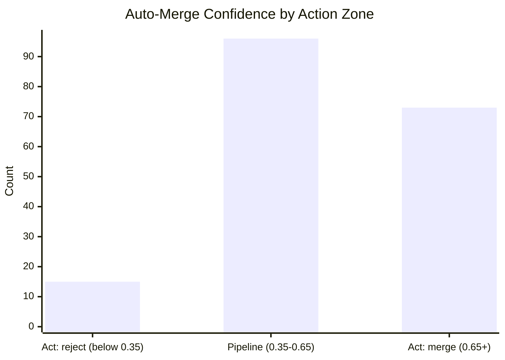
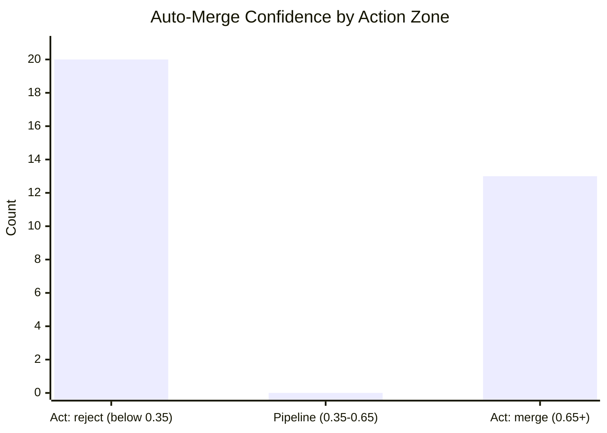

# JEV Report

**Verdict:** Jev agreed on 67% of confident calls (n=9)

## Legend

- **Incumbent decision:** the human/pipeline decision that was actually used
- **Fell back:** Jev returned an uncertain result and deferred to the incumbent
- **Pipeline (0.35–0.65):** confidence too close to call; Jev defers to the incumbent
- **Backfilled:** a decision reconstructed from historical data, not made live

## Counts

- **Total entries:** 343
- **Live entries:** 264
- **Backfilled entries:** 79
- **Date range:** 2026-07-17 to 2026-10-05

## Triage Agreement

- **Agreed:** 6 of 64
- **Disagreed:** 3 of 64
- **Uncertain (fell back):** 55 of 64
- **When confident, agreed:** 6 of 9 (66.7%)
- **Disagreement breakdown:**
  - ready-vs-rejected: 3

### Weekly Trends

| Week | Agreed | Disagreed | Uncertain | n |
|------|--------|-----------|-----------|---|
| 9/21 | 1 | 1 | 19 | 21 |
| 9/28 | 4 | 2 | 31 | 37 |
| 10/5 | 1 | 0 | 5 | 6 |

## Auto-Merge Agreement

- **Mean confidence:** 0.588 (n=184)
- **Median confidence:** 0.590 (n=184)
- **Agreement with incumbent decision:** 70.8% (34/48)

### Per-Zone Agreement

| Zone | Agreed | Total | Agreement |
|------|--------|-------|-----------|
| Act: reject (below 0.35) | 2 | 4 | 50% |
| Pipeline (0.35-0.65) | 19 | 27 | 70% |
| Act: merge (0.65+) | 13 | 17 | 76% |

## Backfill

### Backfill Triage Agreement

- **Agreed:** 22 of 28
- **Disagreed:** 0 of 28
- **Uncertain (fell back):** 6 of 28
- **When confident, agreed:** 22 of 22 (100.0%)

### Weekly Trends

| Week | Agreed | Disagreed | Uncertain | n |
|------|--------|-----------|-----------|---|
| 9/21 | 22 | 0 | 6 | 28 |

### Backfill Auto-Merge Agreement

- **Mean confidence:** 0.459 (n=33)
- **Median confidence:** 0.330 (n=33)
- **Agreement with incumbent decision:** no outcomes yet

---

*Generated at 2026-10-10 21:41 UTC*